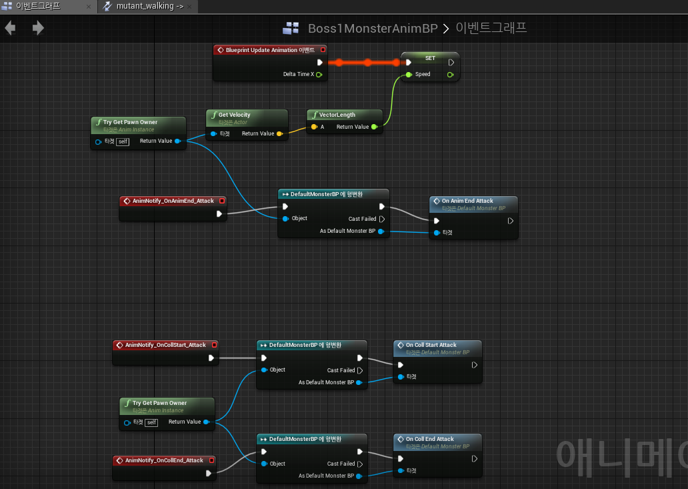

# 1. 프로젝트 개요
### 1.1. 프로젝트명
Dochestra
### 1.2. 프로젝트 설명
문서 파일, 주로 PDF를 위주로 다양한 기능들을 연결해 자유롭게 워크플로를 구축할 수 있는 애플리케이션. 언리얼 엔진의 블루프린트 또는 n8n과 같은 비주얼 스크립트 에디터의 벤치마킹이면서 문서 작업을 대상으로 한다.

### 1.3. 애플리케이션 구성
애플레케이션은 캔버스, 노드, 엣지, 워크플로 총 4가지 개념으로 구성된다.

- 캔버스: 엔드유저가 워크플로를 구성해나가는 GUI 에디터 환경이다. 노드를 배치할 수 있고 엣지를 끌어다놓을 수 있다. 웹 기반으로 작동한다.
- 노드: 하나의 기능 단위이며, 캔버스에서 추가 버튼으로 생성할 수 있고, 좌측 소켓에서 n개의 입력을 받고 우측 소켓에서 n개의 출력을 내보낸다. 노드는 엔진에 미리 정의되고 API에 의해 제공되고 있는 하나의 기능을 GUI로 표시하는 인터페이스이다. 즉 엔진에 정의되지 않은 기능은 노드로 만들 수 없으며, 커스텀 노드 기능도 없다. 
- 엣지: 노드들간의 입력과 출력을 연결하는 선이다. 엣지는 항상 출력->입력 방향으로 진행한다. 노드들의 입출력 데이터의 형식은 이미 정해져있다. 따라서 선의 색상도 타입에 따라 고유 색상으로 표시한다. 노드의 입력 소켓 하나로는 하나의 엣지만 들어올 수 있지만, 노드의 출력 소켓 하나에서는 여러 엣지가 나올 수 있다.
- 워크플로: 엔드유저가 명확한 입력에서부터 최종적으로 원하는 결과물이 나오기까지 캔버스에서 구성한 하나의 작업 파이프라인이다. 캔버스 하나는 워크플로 하나만을 정의하며, 여러개의 워크플로를 정의하지 못한다.

### 1.4. 데이터 타입
노드들간 입력과 출력을 명확하게 하기 위해 데이터 타입을 정한다. 여기서 말하는 타입은 정수형, 실수형과 같은 프로그래밍에서의 데이터타입이 아닌 파일 확장자에 가깝다.

아래의 데이터 타입은 확정되어 있다:
| 타입 | 설명 | 저장 확장자 |
|---|---|---|
| PDF | PDF파일이다. | .pdf |
| MD | Markdown 형식으로 작성된 텍스트이다. | .md |
| JSON | JSON 형식으로 작성된 텍스트이다. | .json |
| CSV | CSV 형식으로 작성된 텍스트이다. | .csv |
| JPG | 이미지 파일이다. | .jpg |
| LIST | 하나의 출력 소켓에서 같은 타입의 데이터가 여러개 나올 경우 해당 타입을 감싸는 리스트 타입이다. 예를 들어 PDF 추출하는 노드의 출력으로 JPG가 있으면, PDF에서는 여러 이미지가 나올수 있으니 해당 소켓의 출력 타입은 LIST\[JPG]가 된다. | 없음 (감싸는 타입에 따름) |
|MP3|음성 파일이다.|.mp3|

### 1.5. 노드 종류
노드는 우선 아래의 기능들을 확정으로 하며, 이후 추가될 수 있지만 기존 노드의 구성과 형식을 참고해 데이터 형식, 틀을 크게 벗어나지 않도록 한다.

|노드명|기능|입력|출력|
|-|-|-|-|
|PDF 번들(bundle)|PDF 파일 여러개를 묶어놓은 것이며 파일시스템과 연동되고 입력 없이 출력만 한다.|없음|LIST\[PDF]|
|추출(extract)|PDF에서 텍스트, 이미지, 표 등을 추출한다.|PDF|MD, JSON, LIST\[CSV], LIST\[JPG]|
|번역(translate)|추출 후 마크다운으로 정제된 PDF를 번역한다. 번역 관련 설정등을 JSON으로 받는다. |MD, JSON|MD|
|이미지 분석(analyze)|LLM이 이미지에 대해 분석한다.|JPG|MD|
|요약(summary)|추출된 PDF 내용을 바탕으로 요약한다. 추출된 이미지 리스트도 넣어 요약에 보탤 수 있다.|MD, LIST\[JPG]|MD|
|슬라이드 생성(slide)|발표 자료 슬라이드를 생성한다.|MD, JPG|PDF|
|해설 음성 생성(voice)|해설 음성을 생성한다.|MD, LIST\[JPG]|MP3|
|폼 자동 입력(fill)|주어진 PDF에 정의된 폼을 인식해 자동으로 채운다. 인식할 폼에 대해서는 JSON으로 키-값 쌍을 받는다.|PDF, JSON|PDF|
|RAG 챗봇(rag)|문서를 바탕으로 RAG를 구축한다. RAG 노드는 JSONㅍ타입으로 APIㅍ호출 정보를 출력한다. |MD|JSON|

### 1.6. 워크플로 실행 순서
워크플로는 실행 순서를 따로 지정하는 선(언리얼 블루프린트의 실행 핀) 없이 데이터 엣지만으로 이루어진 그래프다. 실행 순서는 엔드유저가 정하지 않고 엔진이 엣지의 의존 관계로 정한다. 셰이더 그래프와 같은 방식이다.

실행 전 검증:
- 그래프에 사이클이 있으면 실행하지 않는다.
- 비어 있는 입력 소켓이 있거나 소켓 타입이 맞지 않으면 실행하지 않는다.

실행 단계:
1. 실행 대상 선별: '최종 출력 노드'에서 입력 엣지를 거꾸로 따라가며 도달하는 노드만 실행 대상으로 삼는다. 최종 출력에 닿지 않는 노드는 실행하지 않는다.
2. 실행: 입력이 모두 준비된 노드부터 실행한다(Kahn 방식의 위상 정렬). 노드 하나가 끝나면 그 노드에 연결된 다음 노드들의 남은 입력 수를 줄이고, 남은 입력이 0이 된 노드를 실행 대기열에 넣는다.
3. 동시 실행: 대기열에 함께 들어간 노드들은 서로 의존하지 않으므로 동시에 실행한다.

결과 재사용: 각 노드는 한 번의 워크플로 실행에서 한 번만 실행한다. 출력 소켓 하나에서 엣지가 여러 개 나가도 같은 결과를 나눠 쓰며 노드를 다시 실행하지 않는다.

실패 처리: 노드 하나가 실패하면 그 노드의 결과에 의존하는 노드는 실행하지 않는다.

# 2. 스택 구성
### 2.1. 프론트엔드
React로 웹 애플리케이션을 구성한다.
- 랜딩 페이지: 간단한 소개 페이지 및 시작하기 버튼. 로그인, 회원가입 등의 인증 절차는 생략한다.
- 좌측 사이드바: 워크플로 목록 표시 및 선택.
- 캔버스 및 에디터: 선택한 워크플로에 대한 캔버스 표시. React Flow 라이브러리를 사용해 구현한다.

**프론트엔드 스택 요약**
| 영역 | 선택 | 선정 이유 |
|-|-|-|
| 언어·프레임워크 | TypeScript, React 19 | 노드·소켓 타입을 엔진과 같은 정의로 다루기 위해 TypeScript를 쓴다 |
| 빌드 도구 | Vite | 빠른 개발 서버. 빌드 결과물(정적 파일)은 `web` 컨테이너의 nginx가 제공한다 |
| 패키지 관리 | pnpm, Node.js LTS | 잠금 파일로 의존성을 고정한다 |
| 캔버스 | React Flow (`@xyflow/react`) | 노드 배치, 엣지 연결, 줌·패닝을 제공한다. 노드와 엣지는 커스텀 컴포넌트로 만들어 소켓을 타입별로 표시하고, 엣지는 타입별 고유 색상으로 그린다 |
| 연결 검증 | React Flow `isValidConnection` | 소켓 타입이 다르거나 이미 엣지가 연결된 입력 소켓이면 연결을 막는다(1.3절 규칙). 서버도 같은 검증을 한 번 더 한다 |
| 라우팅 | React Router | 랜딩 페이지와 에디터 두 화면만 있다 |
| 서버 데이터 | TanStack Query | 워크플로 목록, 노드 목록, 워크플로 저장 등 엔진 API 호출과 캐시를 담당한다 |
| 에디터 상태 | Zustand | 캔버스의 노드·엣지·선택 상태를 관리한다. React Flow도 내부에서 Zustand를 쓴다 |
| 실행 상태 수신 | `EventSource` (브라우저 내장) | 엔진의 SSE 스트림을 받아 노드별 상태(대기, 실행 중, 완료, 실패)를 캔버스에 표시한다 |
| API 타입 | ts-rs 생성 타입 | 엔진의 Rust 타입 정의에서 생성한 TypeScript 타입을 그대로 쓴다. 프론트에서 타입을 따로 정의하지 않는다 |
| 스타일 | Tailwind CSS | 사이드바·랜딩 등 단순한 화면을 별도 CSS 파일 없이 만든다 |

### 2.2. 백엔드
백엔드는 두 프로세스로 구성한다. 데이터베이스는 PostgreSQL과 pgvector 확장을 사용한다.
- 엔진: 워크플로 실행기, 노드 구현, API 서버. Rust로 작성한다.
- 추출 워커: 추출(extract) 노드의 실제 처리를 맡는 Python 프로세스. Docling은 Python 전용이며 공식 Rust 바인딩이 없으므로 별도 프로세스로 띄우고, 엔진이 HTTP로 호출한다.

브라우저 요청은 엔진만 받는다. 워커는 Compose 내부 네트워크에만 열어 두고 엔진만 호출한다(2.3절).

**백엔드 스택 요약**
| 영역 | 선택 | 선정 이유 |
|-|-|-|
| 언어·런타임 | Rust (stable), Tokio | 비동기 I/O, 서로 의존하지 않는 노드의 병렬 실행 |
| 웹 프레임워크 | Axum | Tokio 기반이며 tower 미들웨어와 SSE를 기본 지원한다 |
| 데이터베이스 | PostgreSQL 16 + pgvector | 워크플로·실행 기록과 RAG 벡터를 한 DB에서 관리한다 |
| DB 접근 | SQLx | 컴파일 타임 쿼리 검증, `sqlx-cli` 마이그레이션. `pgvector` 크레이트의 sqlx 기능으로 `vector` 타입을 매핑한다 |
| 직렬화 | serde, serde_json | 워크플로 그래프(JSON) 저장 및 API 입출력 |
| 그래프 처리 | petgraph | 실행 전 사이클 검출과 위상 정렬 |
| 실행 상태 전달 | SSE (Axum 내장) | 노드별 진행 상태를 서버에서 브라우저로 단방향 푸시한다 |
| 파일 저장 | 로컬 디스크 (`tokio::fs`) | 모든 파일은 서버 로컬 디스크에만 저장한다 |
| PDF 추출 | Docling (추출 워커) | 레이아웃 분석, 표 구조 인식, 그림 추출, Markdown·JSON 변환을 한 라이브러리에서 처리한다. 별도 PDF 렌더러나 표 추출 도구가 필요 없다 |
| 워커 런타임 | Python 3.10 이상, uv | Docling이 Python 3.10 이상을 요구한다. uv로 의존성을 잠금 파일에 고정한다 |
| 워커 HTTP 서버 | FastAPI, uvicorn | 엔드포인트 2개(추출, 헬스체크)만 둔다 |
| 엔진-워커 통신 | `reqwest` → 워커 HTTP (`http://extractor:8000`) | 엔진이 요청을 보내고 워커가 결과 파일 경로를 응답한다 |
| LLM 호출 | 외부 API |  |
| 임베딩 | 외부 API |  |
| 프론트 타입 공유 | ts-rs | Rust의 노드·소켓·데이터 타입 정의에서 TypeScript 타입을 생성해 React Flow 쪽과 일치시킨다 |
| 로깅·에러 | tracing, thiserror, anyhow | 노드 실행 단위로 span을 남긴다 |

### 2.3. Docker Compose
전체 서비스는 Docker Compose 파일 하나로 띄운다. 컨테이너는 4개이며, 모두 하나의 Compose 기본 네트워크에 속하고 서비스 이름으로 서로를 찾는다. 호스트에 포트를 여는 컨테이너는 `web` 하나뿐이다.

| 컨테이너 | 역할 | 이미지 | 내부 포트 | 호스트 공개 |
|-|-|-|-|-|
| web | 프론트엔드 정적 파일 제공, `/api` 리버스 프록시 | 자체 빌드 (Node → nginx) | 80 | 80 |
| engine | API 서버, 워크플로 실행기, 노드 구현 | 자체 빌드 (Rust → debian-slim) | 8080 | 없음 |
| extractor | Docling 기반 추출 워커 | 자체 빌드 (Python + uv) | 8000 | 없음 |
| db | PostgreSQL + pgvector | `pgvector/pgvector:pg16` | 5432 | 없음 |

요청 흐름: 브라우저 → `web` → (`/api`) → `engine` → `db`, `extractor`

#### 2.3.1. web
- 빌드: 1단계에서 Node 이미지로 React 앱을 빌드(Vite)하고, 2단계 nginx 이미지에 빌드 결과물만 복사한다.
- 정적 파일: SPA이므로 찾을 수 없는 경로는 모두 `index.html`로 돌려준다.
- 프록시: `/api/*` 요청은 `http://engine:8080`으로 넘긴다. 프론트와 API가 같은 출처가 되므로 CORS 설정이 필요 없다.
- SSE: 실행 상태 스트림 경로는 `proxy_buffering off`와 긴 `proxy_read_timeout`을 설정해 이벤트가 바로 전달되게 한다.
- 업로드: PDF 업로드를 위해 `client_max_body_size`를 PDF 크기에 맞게 늘린다.
- 의존: `engine`

#### 2.3.2. engine
- 빌드: 1단계 Rust 이미지에서 릴리스 바이너리를 빌드하고, 2단계 debian-slim 이미지에 바이너리만 복사한다. SQLx 컴파일 타임 검증은 오프라인 모드(`sqlx prepare`로 만든 `.sqlx` 디렉터리)로 해서 빌드할 때 DB 접속이 필요 없게 한다.
- 시작 시 동작: SQLx 마이그레이션을 적용하고 `extractor`의 `/health`를 확인한 뒤 요청을 받는다.
- 볼륨: `data` → `/data` (업로드한 PDF와 노드 산출물)
- 환경 변수: `DATABASE_URL`, `EXTRACTOR_URL=http://extractor:8000`, `DATA_DIR=/data`, LLM·임베딩 API 키
- 의존: `db`(healthy), `extractor`(healthy)

#### 2.3.3. extractor
- 빌드: Python 3.10 이상 이미지에 uv로 잠금 파일 기준 의존성을 설치한다. Docling 모델 파일은 이미지 빌드 단계에서 미리 받아 둔다.
- 볼륨: `data` → `/data`. `engine`과 같은 볼륨을 같은 경로에 마운트하므로, 엔진이 보낸 파일 경로를 워커가 그대로 쓸 수 있다.
- 환경 변수: `DATA_DIR=/data`
- 헬스체크: `GET /health` (모델 로딩 완료 여부). 모델 로딩 시간을 고려해 `start_period`를 넉넉히 둔다.
- 리소스: Docling이 CPU와 메모리를 많이 쓰므로 메모리 한도를 지정한다.

#### 2.3.4. db
- 이미지: `pgvector/pgvector:pg16` (pgvector 확장이 포함된 PostgreSQL 16)
- 초기화: `CREATE EXTENSION vector`와 테이블 생성은 모두 `engine`의 마이그레이션이 맡는다. 확장 생성은 첫 마이그레이션에 넣는다.
- 볼륨: `pgdata` → `/var/lib/postgresql/data`
- 환경 변수: `POSTGRES_USER`, `POSTGRES_PASSWORD`, `POSTGRES_DB`
- 헬스체크: `pg_isready`

#### 2.3.5. 볼륨과 설정
| 이름 | 마운트하는 컨테이너 | 내용 |
|-|-|-|
| data | engine, extractor | PDF 원본과 노드 산출물(MD, JSON, CSV, JPG) |
| pgdata | db | PostgreSQL 데이터 |

비밀번호와 API 키는 저장소에 커밋하지 않는 `.env` 파일에 두고, Compose가 읽어 각 컨테이너에 넘긴다.